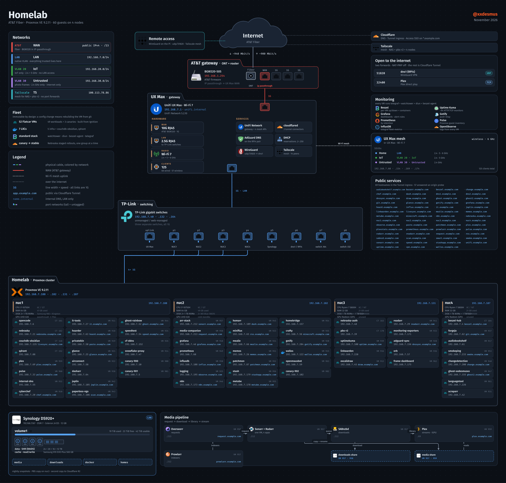

# homelab-diagram

A YAML inventory plus a hand-placed layout that renders this homelab as one big SVG/PNG —
the path from AT&T fiber through the UniFi gateway and the TP-Link switches into the
four-node Proxmox cluster, every guest on it, the Synology storage, and the media pipeline.

Forked from [Goblinmine/homelab-diagram](https://github.com/Goblinmine/homelab-diagram) and
rebuilt for a different topology: a flat `192.168.7.0/24` LAN with two extra VLANs, a
4-node cluster running 60 guests (52 Flatcar VMs + 7 LXCs + one non-Flatcar VM), and
Cloudflare Tunnel ingress instead of port forwards.



## What it shows

- **Edge**: AT&T fiber → BGW320-505 in IP passthrough → UniFi UX Max (gateway + Wi-Fi 7) →
  TP-Link switching. The UX Max also runs the controller and 4 mesh APs.
- **Networks**: LAN (native), IoT (`192.168.20.0/24`), Untrusted (`192.168.30.0/24`) and the
  Tailscale mesh. SSIDs are listed with the VLAN each one lands on.
- **The cluster**: every running guest, grouped by Proxmox node, with `VM`/`CT` id, IP and
  its public hostname or `.internal` name. Facts are rendered from `inventory.yaml`, which was
  filled by reading the live systems.
- **Storage**: the DS920+ `volume1` (4-disk SHR + NVMe cache), its free space, and the four
  shares the media VMs mount.
- **Media pipeline**: request → download → library → stream, with the two shares each stage
  touches.
- **Exposure**: the two real port forwards (WireGuard, Plex) versus the 69 hostnames in the
  Cloudflare Tunnel ingress — 57 of which answered an origin probe; the other 12 point at
  addresses that no longer answer. Plus the monitoring stack.

## How it works

- `inventory.yaml` holds everything the picture shows: networks, devices, switch ports, the
  cluster's nodes and guests, storage, the pipeline, public hostnames.
- `build.py` draws SVG with hand-placed coordinates, embeds icons as base64, and converts to
  PNG with `rsvg-convert -z 1.6` (so PNG pixels = SVG units × 1.6). Text widths are measured
  from the real font with Pillow, and labels that would overflow are shrunk to fit (`fit()`
  in `build.py`); the canvas height is derived from the lowest element, so nothing clips.
- **Redaction**: the default render replaces `paine.pro` with `example.com`, genericises the
  SSIDs, and hides the public WAN address. `python3 build.py --unredacted` renders the real
  values from `inventory.yaml`.

## Requirements

- Python 3 with **PyYAML** and **Pillow**
- **rsvg-convert** (librsvg)
- the fonts **Fira Sans** and **Fira Code**

On Debian/Ubuntu:

```bash
apt install python3-yaml python3-pil librsvg2-bin fonts-firacode
# Fira Sans is not packaged in Debian; fetch it from upstream:
curl -sSL https://github.com/mozilla/Fira/archive/refs/tags/4.202.tar.gz | tar xz -C /tmp
install -m644 /tmp/Fira-4.202/otf/FiraSans-*.otf /usr/share/fonts/truetype/fira/
fc-cache -f
```

## Usage

```bash
python3 fetch_icons.py          # download the service icons into icons/ (once)
python3 build.py                # → out/homelab.svg + out/homelab.png (redacted)
python3 build.py --unredacted   # → out/homelab-unredacted.svg + .png
```

The service icons come from [homarr-labs/dashboard-icons](https://github.com/homarr-labs/dashboard-icons);
only the small `icons/glyph-*.svg` glyphs are part of this repo.

## Adapting it

1. Rewrite `inventory.yaml` for the target network.
2. Adjust the coordinates at the top of `build.py` (`FY/OX/BY/DY` for the vertical chain,
   `PX0/PITCH` for the switch row, `TXX/TWW` for the cluster card, `SY0/STW/MPX` for the
   bottom band). The `assert`s at the end fail loudly when a panel overflows.
3. `python3 fetch_icons.py`, then render and look at the PNG — zoom into busy areas with
   `magick out/homelab.png -crop 1400x600+X+Y +repage -resize 70% /tmp/crop.png`
   (PNG pixels = SVG × 1.6).

## Where the facts came from

Everything in `inventory.yaml` was read live on 2026-11-11, not guessed:

| Source | Used for |
|---|---|
| `pvesh get /cluster/resources` on nuc1 | nodes, guest ids, names, RAM, running state |
| UniFi API (`/proxy/network/api/s/default/*`) | WAN link, VLANs, SSIDs, AP uplinks, port forwards, fixed-IP map |
| `dig @192.168.7.55 <name>.flatcar-lab.internal` | each VM's IP |
| Synology DSM over SSH | model, disks, `volume1` usage, shares |
| `pvesh get /nodes/<n>/status` | CPU model, RAM per node |
| Prometheus `speedtest_tracker_*` | real WAN throughput |
| `tunnel-migration/production-ingress.json` | the 69 hostnames, each TCP-probed for a live origin |
| `pvesh` guest tags | 52 `flatcar-*` QEMU VMs (49 workloads + 3 canaries), 7 LXCs, 1 Debian VM |

## Credits & license

- Original code, layout and the `glyph-*.svg` icons: MIT, see [LICENSE](LICENSE) —
  © the upstream author.
- Service icons: [homarr-labs/dashboard-icons](https://github.com/homarr-labs/dashboard-icons);
  the logos belong to their projects.
- Fonts: Fira Sans / Fira Code (SIL Open Font License).
